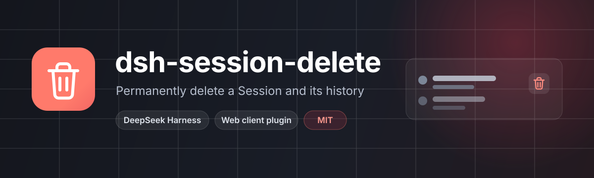

<p align="center">
  
</p>

<p align="center">
  <a href="https://github.com/Yornii/dsh-session-delete/actions/workflows/ci.yml"></a>
  <a href="https://github.com/Yornii/dsh-session-delete/blob/main/LICENSE"></a>
  <a href="https://github.com/Yornii/dsh-session-delete"></a>
</p>

A DeepSeek Harness (DSH) web-client plugin that turns a Session row's hover **archive** button into **delete**: after a confirmation, the Session and its saved conversation history are permanently removed.

> 中文: [README.md](README.md)

## 🎯 Why

DSH's sidebar only offers *archive*: the Session disappears from the list but its `jsonl` record stays on disk forever. Cleaning up for real means digging through the `sessions` directory by hand, and first proving that a folder belongs to exactly one Session.

This plugin adds the missing step: trash icon on the row → confirm → the Host stops running work, validates the target directory, removes the record, and the list drops the row immediately.

## ✨ Features

| Capability | Detail |
| --- | --- |
| Row action | A trash icon replaces the shipped archive button in the same slot and position |
| Confirmation | The dialog shows the Session title and states that deletion is permanent; running Sessions also warn that their work will be stopped first |
| Keyboard support | Focus starts on Cancel; `Esc` and backdrop clicks close it; `Tab` cycles inside the dialog |
| Instant removal | On success the client drops the row via the `api-session/removed` event — no full page refresh |
| Safe by construction | Only a directory proven to belong to the Session is removed; any unexpected entry aborts the deletion |
| Bilingual | Ships Simplified Chinese and English dictionaries and follows the DSH locale |
| Theme-aware | All styles use DSH theme variables, so light and dark themes both work |

## 📦 Install

Requirements: a DSH 0.2.x web profile (developed and verified on 0.2.2-rc.1). The plugin has both a Host and a Client half and must be installed into the profile that serves the web UI.

Pick one:

```sh
# From GitHub (use this until it is on npm)
dsh plugin --profile web add github:Yornii/dsh-session-delete

# Once published to npm
dsh plugin --profile web add @yornii/dsh-session-delete
```

Replace `web` with your profile name (the desktop build uses `desktop`). You can also clone the repository and install the local directory:

```sh
git clone https://github.com/Yornii/dsh-session-delete.git
dsh plugin --profile web add ./dsh-session-delete
```

Restart DSH afterwards (the Host composes the profile at boot) and reload the page; the plugin appears as "Session delete" in the plugin list. Uninstalling or disabling it restores DSH's own archive button.

## 🗑️ Usage

1. Hover a Session in the sidebar and click the trash icon on its row.
2. Check the title in the confirmation dialog. A running Session adds a note that its work will be stopped first.
3. Click **Delete permanently**. The button turns into "Deleting…"; on success the dialog closes and the row disappears.
4. On failure the dialog stays open, shows the reason above the buttons, and you can retry or cancel.

Deletion is also available as a command from inside a Session (that is exactly what the dialog runs):

```text
/delete-session <this-session-id>
```

The command only accepts the ID of the Session it runs in — any other ID is rejected, which makes accidental cross-Session deletion impossible. This `delete-session` command is the stable public entry point used by the batch-delete features of `dsh-session-unfold` and `dsh-task-board`.

## 🔍 What deletion actually does

```text
Click delete
  └─ Client: confirmation → run /delete-session <id>
      └─ Host: the id must equal the current Session
          ├─ If the Session is live: archive it (so a refresh does not bring it back) → wait up to 2.5s for idle
          ├─ Detach it from every Workspace's session accounting
          ├─ Validate the on-disk directory: the file must be session[.vN].jsonl[.zstd]
          │                                only session logs, session.lock and *.tmp may be present
          ├─ Wait 400ms so the command runner's own log writes land before the directory goes away
          └─ Remove the directory recursively → emit api-session/removed → the row disappears
```

The failure path is safe: if validation fails, removal throws, or the plugin unloads, scheduled deletions are cancelled and the archive marker this plugin wrote is rolled back.

## 🔒 Safety boundaries

- **Only the Session's own directory**: the directory is the parent of the physical log path reported by the persistence layer, and it is removed only if every entry is a Session artifact (log generation, `session.lock`, `*.tmp`). Anything else aborts the whole deletion.
- **No "delete by arbitrary ID" API**: the command input must match the ID of the Session it runs in.
- **No recycle bin**: this is `rm -rf` semantics. A deleted Session cannot be restored from the archive and does not go to the OS trash.
- **Deletion is delayed by 400ms** so the command runner's post-handler writes finish first instead of re-creating the directory.
- **Non-jsonl stores are refused** with an explicit error rather than guessing a path.

## ⚠️ Known limitations

- While enabled, the row's **archive button is replaced**. Disable the plugin if you need archive.
- Permanent deletion cannot be undone; there is no "recently deleted".
- One Session per action. For batch deletion use `dsh-session-unfold` or `dsh-task-board`.
- Directory validation is strict: a Session folder polluted with unrelated files makes deletion fail until you clean it up yourself.
- Only the jsonl Session store (DSH's default) is supported; custom stores are not.
- If the Host dies mid-deletion, the directory may be partially removed; retrying normally clears the rest.
- With several clients open, the removal event reaches all of them, but another client's already-rendered transcript is not cleared until it reloads.

## 🧩 Implementation

| File | Role |
| --- | --- |
| `index.js` | Host half: registers the `delete-session` command, archive/detach/validate/delayed removal/rollback |
| `client.js` | Client half: row delete button, confirmation dialog, zh/en dictionaries and styles |
| `cordis.patch.yml` | Bundle declaration that inserts the plugin into the profile's plugin stack |
| `locale/*.json` | Plugin metadata (title and description) in Chinese and English |
| `icon.svg` | Plugin icon |
| `tools/host-test.mjs` | Offline Host-half test using a temporary directory and fake services |

Host services: `commands`, `sessions`, `sessionPersistence`, `workspaceRegistry`.
Client services: `slots`, `locale`, `sessions`, `remote`, `remote.commands`.
Slots: `sidebar.workspaces.session.row.action` (id `archive`, priority `-1`, replacing the shipped button) and `shell.overlay` (the confirmation dialog).

## 🧪 Self-check

```bash
npm run check          # syntax: node --check index.js && node --check client.js
npm test               # 19 offline Host assertions using a temporary directory and fake services
```

`tools/host-test.mjs` needs no browser or real DSH. It covers cold-Session deletion, archiving and idle-waiting for a live Session, refusal of a foreign ID, unknown Sessions, refusing a directory with unrelated files while rolling the archive back, immediate announcement for a memory-only Session, treating `session.lock` / `*.tmp` as Session artifacts, and refusing non-jsonl stores.

Manual acceptance:

1. Install and reload: hovering a Session row shows the trash icon and the archive button is gone.
2. Open the dialog: title and description are correct; `Esc` closes it; focus starts on Cancel.
3. Delete an idle Session: the row disappears after roughly half a second and `$DSH_HOME/sessions/<workspace>/<session-id>/` is gone.
4. Delete a running Session: its work stops first, then the directory is removed and it stays gone after a refresh.

## 🩺 Troubleshooting

| Symptom | Cause / fix |
| --- | --- |
| No trash icon in the sidebar | The plugin is disabled or its Client half did not load; enable it in the plugin manager and reload |
| "Command unavailable" | The Host half is not installed in the current profile or the plugin is disabled; install it into the same profile and restart |
| `refusing to delete ... unexpected entry` | The Session directory contains non-Session files; inspect it, move them away, retry |
| `not a session log file` | The persistence layer reported a path that is not `session*.jsonl*`; keep the logs and report it |
| The row is still there right after deleting | Removal is intentionally delayed by ~400ms; wait or reload. If it persists, look for `dsh-session-delete:` warnings in the Host log |
| I want the archive button back | Disable this plugin |

## 📄 License

[MIT](LICENSE) © 2026 Yornii
