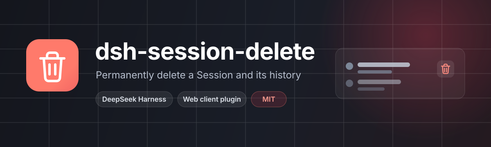

<p align="center">
  
</p>

<p align="center">
  <a href="https://github.com/Yornii/dsh-session-delete/actions/workflows/ci.yml"></a>
  <a href="https://github.com/Yornii/dsh-session-delete/blob/main/LICENSE"></a>
  <a href="https://github.com/Yornii/dsh-session-delete"></a>
</p>

一个 DeepSeek Harness（DSH）Web 客户端插件：把会话行悬停时的「归档」按钮换成「删除」，二次确认后永久删除该会话及其保存的对话记录。

> English: [README.en.md](README.en.md)

## 🎯 它解决什么

DSH 侧边栏原本只提供「归档」——会话从列表里消失，但 `jsonl` 记录仍留在磁盘上，越积越多。想彻底清理时，只能手动去 `sessions` 目录里翻文件夹，还得先确认那个文件夹确实只属于这个会话。

这个插件补上缺失的一步：在会话行上点垃圾桶 → 确认 → Host 停止正在运行的工作、校验目标目录、删除记录，并让列表立即少一行。

## ✨ 功能

| 能力 | 说明 |
| --- | --- |
| 行内删除入口 | 侧边栏会话行悬停出现垃圾桶，替换原来的「归档」按钮（同一槽位、同一位置） |
| 二次确认 | 弹窗显示会话标题，并明确「永久删除、无法恢复」；运行中的会话会额外提示「删除前先停止工作」 |
| 键盘可用 | 打开时焦点落在「取消」；`Esc`、点遮罩可关闭；`Tab` 在弹窗内循环 |
| 立即收起 | 删除成功后通过 `api-session/removed` 事件让列表直接去掉该行，不必整页刷新 |
| 安全删除 | 只删除被证实属于该会话的目录；发现任何非会话文件就中止 |
| 中英双语 | 跟随 DSH 语言设置，界面文案内置 zh / en 两套 |
| 主题一致 | 样式全部使用 DSH 主题变量，明暗主题都正常 |

## 📦 安装

要求：DSH 0.2.x 的 Web profile（在 0.2.2-rc.1 上开发验证）；插件同时包含 Host 与 Client 两半，必须装进正在提供 Web 界面的那个 profile。

任选一种方式：

```sh
# 从 GitHub 安装（尚未发布到 npm 时用这个）
dsh plugin --profile web add github:Yornii/dsh-session-delete

# 发布到 npm 后
dsh plugin --profile web add @yornii/dsh-session-delete
```

`--profile web` 换成你实际使用的 profile 名（桌面版默认是 `desktop`）。也可以克隆仓库后直接安装本地目录：

```sh
git clone https://github.com/Yornii/dsh-session-delete.git
dsh plugin --profile web add ./dsh-session-delete
```

装好后重启 DSH（Host 在启动时组装 profile），再刷新页面；插件列表里出现「会话删除」即生效。卸载或禁用后，侧边栏会恢复 DSH 自带的归档按钮。

## 🗑️ 使用

1. 在侧边栏找到要删除的会话，鼠标悬停，点击右侧垃圾桶。
2. 确认弹窗里核对会话标题；如果它还在跑，会提示「删除前会先停止它」。
3. 点「永久删除」。按钮变为「正在删除…」，成功后弹窗关闭、该行从列表消失。
4. 失败时弹窗不关，错误原因直接显示在按钮上方，可以重试或取消。

删除动作也可以直接在会话里用命令触发（弹窗内部走的就是同一条路径）：

```text
/delete-session <当前会话 ID>
```

命令只接受**它自己所在会话**的 ID——传入别的 ID 会被拒绝，避免误删。这个 `delete-session` 命令是稳定的公共入口，`dsh-session-unfold`、`dsh-task-board` 的批量永久删除都调用它。

## 🔍 删除时到底发生了什么

```text
点击删除
  └─ Client：弹出确认框 → 执行 /delete-session <id>
      └─ Host：校验 id 必须等于当前会话
          ├─ 若会话仍活着：写入归档标记（刷新后也不会回来）→ 最多等 2.5s 让其空闲
          ├─ 从所有 Workspace 的会话账目中摘除
          ├─ 校验磁盘目录：文件名必须是 session[.vN].jsonl[.zstd]
          │                目录里只允许会话日志、session.lock、*.tmp
          ├─ 等 400ms（让命令自身的日志写完，避免删完又被重建）
          └─ 递归删除该目录 → 广播 api-session/removed → 列表移除该行
```

失败路径是安全的：目录校验不通过、删除抛错或插件卸载时会取消尚未执行的删除，并把本插件写入的归档标记回滚。

## 🔒 安全边界

- **只删会话自己的目录**：以持久化层报告的文件路径为准，向上取一层目录；目录里出现任何非会话文件（附件、导出物、别的日志）就整体拒绝。
- **不提供按 ID 删任意会话的接口**：命令入参必须与命令所在会话一致。
- **没有回收站**：`rm -rf` 语义，删除后无法从「已归档」找回，也不进系统回收站。
- **动作延后 400ms**：命令运行器会在 handler 返回后继续写日志；先等写盘结束再删，避免目录被重新创建。
- **非 jsonl 存储不支持**：遇到其他 Session store 类型会明确报错，而不是猜测路径。

## ⚠️ 已知限制

- 启用后会**替换**侧边栏行上的归档按钮；仍需要归档的话，请临时禁用本插件。
- 永久删除不可撤销，也没有「最近删除」。
- 一次只处理一个会话；批量删除请配合 `dsh-session-unfold` 或 `dsh-task-board`。
- 目录校验很严格：如果会话目录被手工塞进其他文件，删除会被拒绝，需要先自行清理。
- 只支持 jsonl 会话存储（DSH 默认存储）；自定义 session store 不支持。
- 删除时若 Host 端异常退出，目录可能已经删了一半；重试通常能清掉剩余部分。
- 多个窗口/客户端同时打开时，删除会广播给所有客户端，但其他客户端上已渲染的历史消息不会立刻清空，刷新后消失。

## 🧩 实现

| 文件 | 作用 |
| --- | --- |
| `index.js` | Host 半：注册 `delete-session` 命令，归档/摘除/校验/延时删除/回滚 |
| `client.js` | Client 半：注册行内删除按钮、确认弹窗、中英词典与样式 |
| `cordis.patch.yml` | bundle 声明，把插件插入 profile 的插件栈 |
| `locale/*.json` | 插件元数据的中英文标题与描述 |
| `icon.svg` | 插件图标 |
| `tools/host-test.mjs` | Host 半离线测试，用临时目录和假服务覆盖删除与拒绝路径 |
| `tools/package-test.mjs` | 包元数据一致性测试：包名、模块 id、bundle patch、exports、locale 与 files |

Host 注入的服务：`commands`、`sessions`、`sessionPersistence`、`workspaceRegistry`。
Client 注入的服务：`slots`、`locale`、`sessions`、`remote`、`remote.commands`。
槽位：`sidebar.workspaces.session.row.action`（id `archive`，priority `-1`，覆盖内置按钮）与 `shell.overlay`（确认弹窗）。

## 🧪 自检

```bash
npm run check          # 语法检查：node --check index.js && node --check client.js
npm test               # 19 项 Host 断言 + 20 项包元数据一致性检查
```

`tools/host-test.mjs` 不依赖浏览器或真实 DSH，覆盖：冷会话删除、运行中会话先归档并等待空闲、外部 ID 拒绝、未知会话、目录中混入无关文件时拒绝并回滚归档、内存会话立即广播、`session.lock` / `*.tmp` 视为会话产物、非 jsonl 存储拒绝。`tools/package-test.mjs` 校验包名、Client 模块 id、bundle patch、`exports`、locale 与 `files` 是否一致，防止重命名后各处名字不同步。

手工验收：

1. 安装并刷新，悬停会话行应出现垃圾桶，原归档按钮消失。
2. 点垃圾桶，确认框标题与描述正确；`Esc` 能关闭，焦点先在「取消」。
3. 删除一个空闲会话，约半秒后行消失，`$DSH_HOME/sessions/<workspace>/<session-id>/` 目录被移除。
4. 删除一个运行中的会话，应先停止其工作再删除，且刷新后不再出现。

## 🩺 故障排查

| 现象 | 原因 / 处理 |
| --- | --- |
| 侧栏没有垃圾桶 | 插件未启用或 Client 未加载：在插件管理器确认已启用，然后刷新页面 |
| 提示命令不可用 | Host 半没装进当前 profile，或插件被禁用；确认安装在同一个 profile 后重启 |
| 报 `refusing to delete ... unexpected entry` | 会话目录里有非会话文件；先手动检查并移走，再重试 |
| 报 `not a session log file` | 持久化层返回的路径不是 `session*.jsonl*`，属于异常状态，请保留日志反馈 |
| 点了删除但行还在 | 删除有约 400ms 延迟；稍等或刷新。仍不消失就看 Host 日志里的 `dsh-session-delete:` 警告 |
| 想恢复归档按钮 | 禁用本插件即可 |

## 📄 许可

[MIT](LICENSE) © 2026 Yornii
